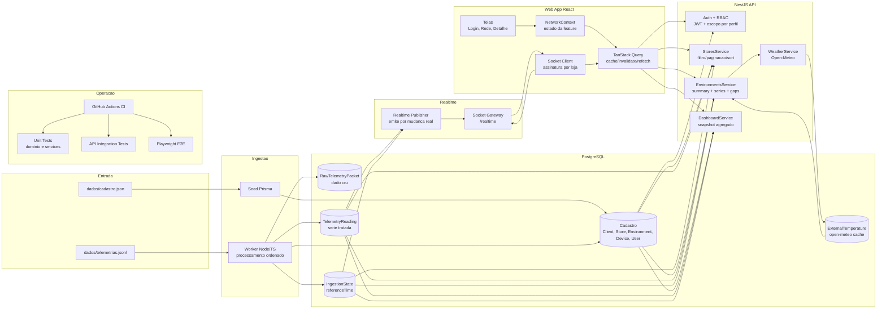

# Arquitetura - Celsius 360

## Diagrama completo

## Fluxo ponta a ponta

1. O seed carrega cadastro base no banco.
2. O worker le o JSONL em ordem, grava dado cru e gera serie tratada idempotente.
3. O worker atualiza status de dispositivo/ambiente e o referenceTime da plataforma.
4. A API aplica RBAC e entrega consultas de rede, ambiente e dashboard.
5. O publisher observa mudancas reais de referencia e dispara eventos realtime.
6. O frontend atualiza dados via query cache e assinatura socket por loja.
7. CI valida build e testes para manter confiabilidade de entrega.

## Fronteiras de responsabilidade

- Worker: ingestao e enriquecimento de telemetria.
- API: regras de acesso, agregacao e contrato HTTP/WebSocket.
- Frontend: experiencia de uso, estado de tela e visualizacao.
- Banco: persistencia de cadastro, cru, tratado e referencia temporal.

## Decisoes e trade-offs

- Banco unico PostgreSQL na entrega inicial: reduz complexidade operacional e acelera implementacao.
- Separacao logica de cru e tratado no schema: prepara evolucao para armazenamento especializado.
- Realtime por mudanca real + rooms por loja: minimiza invalidacoes e trafego desnecessario.
- Agregacao temporal no backend: melhora custo de render e resposta para periodos longos.

## Evolucao para escala de producao

1. Manter cadastro relacional no PostgreSQL.
2. Mover dado cru para object storage em formato colunar (lakehouse).
3. Mover serie tratada para engine temporal dedicada ou Postgres particionado.
4. Criar agregados materializados para dashboard de baixa latencia.
5. Introduzir fila e multiplos workers para paralelizar ingestao com controle de backpressure.
